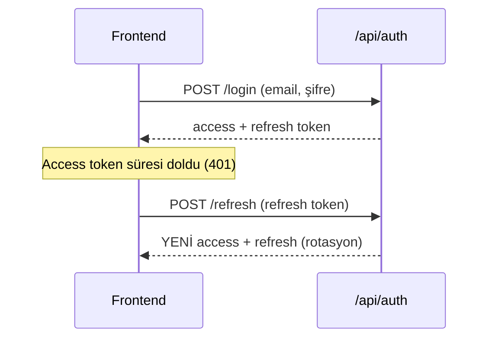
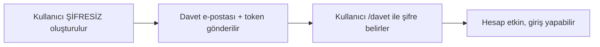

# 05 — Kimlik & Yetkilendirme

Kullanıcı nasıl giriş yapar, oturum nasıl korunur, roller nasıl uygulanır ve yeni
kullanıcılar nasıl güvenli kurulur — hepsi burada.

## JWT + Refresh Token

Giriş başarılı olunca backend iki token üretir:

- **Access token (JWT):** Kısa ömürlü (varsayılan 60 dk). Her istekte
  `Authorization: Bearer <token>` başlığında gider. İçinde **claim'ler** taşır:
  `sub` (kullanıcı id), `name`, `email`, `role`, `employeeId`, **`tenant`** (kiracı id).
- **Refresh token:** Uzun ömürlü (varsayılan 7 gün). Access token süresi dolunca
  yenisini almak için kullanılır. DB'de **hash'lenmiş** saklanır.



**Refresh rotasyonu:** Her refresh'te eski refresh token iptal edilir ve yeni bir
çift üretilir. Çalınmış bir refresh token'ın tekrar kullanımını sınırlar. Bu mantık
frontend'de `api/client.ts` (tek-uçuş refresh), backend'de `IdentityService`'tedir.

### Refresh token'lar nerede durur — ve neden orada

Kullanıcılar ve İK verisi **kiracı** veritabanında, refresh token'lar ise
**platform** veritabanındadır.

Sebep bir yönlendirme problemi: login'de kullanıcı e-postasını verir ve hangi
kiracıya bakılacağı yönlendirme dizininden çözülür. Refresh'te ise elde yalnız
rastgele bir dize vardır — dizin yardım edemez. Token satırı platformda durduğu
ve `TenantId` taşıdığı için, arama tek bir yerde yapılır ve kiracı oradan
öğrenilir. Token biçimi bu sayede değişmedi.

İki sonucu var:

- `RefreshTokens.UserId → Users.Id` yabancı anahtarı **yoktur** — SQL Server
  çapraz-veritabanı FK'yı desteklemez. Kullanıcı, `TenantId` ile açılan kiracı
  kapsamından bu kimlikle çözülür.
- Bir kiracıyı yedekten geri yüklemek **oturumları geri sarmaz**; kullanıcıları
  yeniden giriş yapar (bkz. `docs/yedekleme-ve-kurtarma.md`).

### Kullanıcı işlemleri kiracıya sabitlenmiş kapsamda çalışır

`UserManager`, `AddEntityFrameworkStores<AppDbContext>` ile uygulama context'ine
bağlıdır; o da bağlantısını aktif kiracıdan alır. Bu yüzden `IdentityService`
onu constructor'dan almaz — kiracı, DI kapsamı kurulduğunda henüz bilinmiyor
olabilir (login'de ancak dizin sorgusundan sonra öğrenilir).

Her işlem kiracıyı önce çözer, sonra `ITenantScopeFactory.Create(...)` ile
kapsam açar ve `UserManager`/`SignInManager`'ı **o kapsamdan** alır. İkisinin
aynı kapsamdan gelmesi zorunludur: `CheckPasswordSignInAsync` kilitleme
sayacını `UserManager` üzerinden yazar.

## Roller ve Policy'ler

Üç rol: `hr-admin`, `manager`, `employee`. Backend'de policy'lerle uygulanır
(`Program.cs` + `Policies` sabitleri):

```csharp
[Authorize(Policy = Policies.HrAdminOnly)]   // yalnız hr-admin
[Authorize(Policy = Policies.Management)]     // hr-admin + manager
[Authorize(Policy = Policies.PayrollAccess)]  // hr-admin + employee
```

Ek olarak **kapsam daraltma** vardır: bir `manager` yalnız kendi ekibini, bir
`employee` yalnız kendini görür. Bu, handler'larda `ICurrentUser.EmployeeId` ile
sorguları filtreleyerek yapılır (ör. `GetTeamLeavesQuery` yöneticinin ekibiyle sınırlar).

> **Kural:** Yetki iki katmanlıdır — (1) policy rolü kontrol eder, (2) sorgu kapsamı
> kullanıcının görebileceği satırları daraltır. İkisi birlikte "yatay yetki yükseltme"yi
> (başka çalışanın verisini görme) engeller.

### Kiracı kapısı: 403 mü, 503 mü?

Rol kontrolünden ÖNCE bir kapı daha var — kiracının kendisi erişilebilir mi?

| Durum | Kod | Anlamı |
| --- | --- | --- |
| Kiracı `Frozen` / `Purging` / yok | **403** | "Şirket hesabınız kullanıma kapalı" — kalıcı bir engel, yeniden denemek çözmez |
| Kiracının şeması dağıtımın gerisinde | **503** | "Sistem güncelleniyor" — geçici, birazdan düzelir |

Ayrım önemli: 403 kullanıcıya "senin hakkın yok" der ve destek aramasına yol
açar; 503 "şu anda değil" der ve istemcinin yeniden denemesini söyler. İkisi de
`ITenantAccessGuard.EnsureAccessibleAsync` içinden geçer — o metot hem token
üretiminin (login/refresh) hem yetkili isteğin ortak yolu olduğu için tek bir
kontrol iki darboğazı da kapatır.

## Güvenli Kullanıcı Kurulumu: Davet Akışı

Yeni kullanıcılar **paylaşılan geçici şifre almaz.** Bunun yerine:



Bu akış iki yerde tetiklenir:
- **Kiracı provizyonu:** ilk `hr-admin` şifresiz oluşur, davet alır.
- **İşe alım (hire):** aday `employee`'ye dönüşünce şifresiz login + davet alır.

**Uçlar:**
- `POST /api/auth/accept-invite` — davet token'ıyla ilk şifreyi belirler (anonim).
- Token geçersiz/süresi geçmişse reddedilir.
- **KİRACI DURUMUNU DEĞİŞTİRMEZ.** Şifre belirlemek kullanıcının hesabını
  kullanılabilir yapar, kiracıyı değil. Eskiden `Provisioning` bir kiracıyı
  `Active`'e çekiyordu (self-servis kaydın e-posta doğrulama kapısıydı); o akış
  kalkınca geriye yalnız zararı kalırdı — `Provisioning`'de takılı bir kiracı
  "veritabanı henüz kurulmadı" demektir ve onu açmak kullanıcıyı var olmayan bir
  kataloğa sokar. Durum geçişleri provizyon yolunun işidir
  (`KiraciDurumMakinesiTests`).
- Frontend sayfası: `/davet?email=...&token=...` (`AcceptInvitePage.tsx`). Eski
  `/#/accept-invite?...` e-posta linkleri `legacyHash.ts` tarafından bu yola
  çevrilir.

Davet e-postaları `Email:Mode` ayarına göre gider: `outbox` (dev — dosyaya yazar)
veya `smtp` (üretim — MailKit). Detay: [06](06-multi-tenancy.md) ve KVKK dokümanı.

## Kayıt Uçları — Kim Ne Yapar?

| Uç | Kim çağırır | Sonuç |
| --- | --- | --- |
| `POST /api/tenants` | Platform (X-Platform-Key) | Yeni kiracı + ilk hr-admin (provizyon) |
| `POST /api/tenants/{id}/resend-invite` | Platform (X-Platform-Key) | Şifresi HİÇ belirlenmemiş hesaba daveti yeniden gönderir (etkin hesapta 409) |
| `POST /api/auth/accept-invite` | Davetli kullanıcı (token'la) | Şifre belirler, hesabı etkinleştirir |

**Uygulamada hiçbir kayıt (signup) ucu yoktur.** Yeni şirket yalnız operatör
tarafından platform anahtarıyla açılır; mevcut bir şirkete katılmanın tek yolu
davettir. Personel, işe alım akışıyla (aday → personel) oluşturulur ve davet
e-postası alır.

> **⚠️ `POST /api/tenants/signup` KALDIRILDI — yeniden eklemeyin.**
>
> Kiracı başına ayrı veritabanına geçildikten sonra self-servis kayıt, anonim bir
> isteğin **veritabanı oluşturması** anlamına geliyordu — internetten herhangi biri
> disk ve yedekleme maliyetini istediği kadar şişirebilirdi. Regresyon testi:
> `SelfServisKayitKaldirildiTests`.

> **⚠️ `POST /api/auth/register` KALDIRILDI — yeniden eklemeyin.**
>
> Bu uç anonimdi ve her yeni kullanıcıyı **platformdaki en düşük Id'li kiracıya**
> (üretimde gerçek bir müşteriye) bağlıyor, `EmailConfirmed=true` yapıyor ve
> token'ı erişim kapısını **bilinçli atlayarak** üretiyordu. Sonuç: internetten
> herhangi biri kaydolup o müşterinin İK verisini okuyabiliyordu — personel
> sayısı, bekleyen izinler, izindekiler, aday hunisi, `/api/me`,
> `/api/payroll/my`, `/api/leaves/*`.
>
> Bu belgede daha önce yer alan "rolü daima `employee` atıyoruz, o yüzden
> güvenli" notu **yanlıştı**: sorun yetki yükseltmesi değil, **yanlış kiracıya
> bağlanmaktı.**
>
> `AuthFlowTests` içinde bu ucun 404 döndüğünü doğrulayan bir regresyon testi var.

## Sonraki Adım

Kiracı izolasyonunun tamamı → [06 — Multi-Tenancy](06-multi-tenancy.md).
