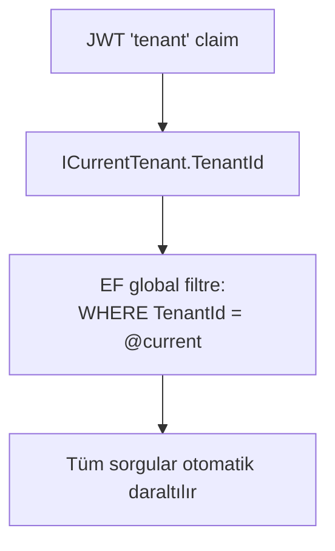

# 06 — Multi-Tenancy (Çok Kiracılılık)

İK Pro çok müşterili bir SaaS'tır: birçok şirket (kiracı) aynı uygulamayı
paylaşır ama **hiçbiri diğerinin verisini göremez.** Bu rehber bu izolasyonun
nasıl sağlandığını anlatır. (Uyum/KVKK detayı: [`../kvkk-veri-izolasyonu.md`](../kvkk-veri-izolasyonu.md).)

## İzolasyon Modeli: Kiracı Başına Veritabanı (geçiş sürüyor)

Her kiracı **kendi veritabanında** yaşar: `Tenants.DatabaseName` katalog adını
taşır, bağlantı çözücü kiracıdan o adı üretir.

**Neden ayrıldık?** Tek müşteriyi, diğerlerine dokunmadan ve saniye hassasiyetinde
geri yükleyebilmek için. Ortak veritabanında bir müşterinin "dünkü hâline dönün"
talebi, ya herkesi geri sarmayı ya da satır satır elle onarımı gerektirirdi.

Ayrılma tamamlandı: geliştirme kurulumunda demo kiracılar `IKPro_demo` ve
`IKPro_globex` kataloglarında yaşıyor, paylaşılan `IKProDb` **boş**.

> **`DatabaseName` yine de boş olabilir** ve bu bir hata değildir — boş ad "henüz
> paylaşılan veritabanında" demektir. Mekanizma bilinçli olarak korunuyor: ileride
> bir kiracıyı taşımak ya da bir kurulumu kademeli ayırmak gerekirse yol açık kalsın.
>
> **`TenantId` sütunu ve global sorgu filtresi de kalkmadı.** Ayrılmış kiracılarda
> ikinci bir güvenlik katmanı olarak duruyorlar: bağlantı çözümü yanlış katalogu
> verse bile filtre veriyi karıştırmaz. İki bağımsız savunma, tek bir kusursuz
> savunmadan iyidir.

> **Sıfırlarken:** `IKProDb` + `IKProPlatform` düşürmek yetmez; tüm `IKPro_*`
> kiracı veritabanlarını da birlikte düşürün. Aksi halde provizyon "katalog zaten
> var" diye reddeder.

## Çekirdek Garanti: Global Sorgu Filtresi

> EF Core, kiracı-kapsamlı **her** varlığa otomatik olarak `WHERE TenantId = @current`
> ekler. Uygulama kodu bu filtreyi elle yazmaz — dolayısıyla "filtre eklemeyi unutma"
> sızıntısı **yapısal olarak imkânsızdır.**

Nasıl çalışır:
1. `ITenantScoped` arayüzü (`int TenantId { get; set; }`) izolasyona tabi tipleri işaretler.
   `BaseEntity` bunu uygular → ondan türeyen her varlık otomatik dahil olur.
2. `AppDbContext`, model kurulumunda **reflection** ile `ITenantScoped` uygulayan her
   tipi bulur ve her birine `HasQueryFilter(e => e.TenantId == CurrentTenantId)` uygular.
3. Aktif kiracı `ICurrentTenant.TenantId`'den gelir; HTTP isteğinde JWT `tenant` claim'inden okunur.
4. Yeni kayıtlar `AuditableEntityInterceptor` tarafından kaydetme anında otomatik
   `TenantId` ile damgalanır — elle set etmeye gerek yok.

## Katman Katman İzolasyon

İzolasyon yalnız EF varlıklarında değil, **veriye erişen her yolda** uygulanır:

| Katman | Nasıl |
| --- | --- |
| Yazılabilir varlıklar | `BaseEntity : ITenantScoped` + global filtre |
| SQL view / okuma modelleri | View'ler `TenantId` sütununu kendileri taşır (EF filtresini baypas eder) |
| SQL fonksiyonu | `fn_WorkingDays(@start, @end, @tenantId)` — kiracı parametresi zorunlu |
| Audit trigger'ları | Etkilenen satırın `TenantId`'sini kopyalar |
| Dosya/blob | Erişim, tenant-kapsamlı DB satırından geçer → yabancı kiracı 404 alır |
| Kimlik | `ApplicationUser.TenantId`; pasif kiracıya giriş reddedilir |

Bu izolasyon **testlerle kanıtlanır** (`tests/.../Tenancy/`): Kiracı A asla Kiracı B'nin
verisini göremez. Bu, ürünün en kritik güvencesidir.

## `Impersonate` Ne İşe Yarar?

HTTP isteği olmayan bağlamlarda (seed, arka plan servisi, purge) JWT yoktur ve
kiracı elle sabitlenmelidir. Bunun **doğru yolu `ITenantScopeFactory.Create(id)`**:
kiracıyı kapsam çağırana dönmeden önce sabitler, dolayısıyla kapsamdan çözülen her
servis — `AppDbContext` dahil — doğru kiracıyı görür.

`ICurrentTenant.Impersonate` bu fabrikanın **içinde** kullanılır; dışarıdan doğrudan
çağrılmaz. Sebebi: `AppDbContext`'in bağlantısı kapsam başına, ilk çözümde belirlenir
— context zaten çözüldükten sonra `Impersonate` çağırmak hata FIRLATMAZ, sadece
sessizce yanlış veritabanına yazar. Örnek doğru kullanım: `TenantPurger` ve
`AppDbContextInitializer` (bkz. [07](07-veritabani-ve-migrationlar.md)).

## Kiracı Nasıl Oluşur?

**Tek yol var:** `POST /api/tenants` — `X-Platform-Key` başlığıyla korunur (normal
rol sisteminin dışında, platform operasyonu).

Provizyon **altı adımdır** ve sıra kritiktir:

1. Platform veritabanında, **tek transaction**: kiracı satırı (`Provisioning`,
   `DatabaseName` üretilmiş) + e-posta rezervasyonu. Birlikte olmalılar; ayrı
   olsalardı rezervasyon çakıştığında geriye slug'ı işgal eden sahipsiz bir
   kiracı satırı kalırdı.
2. `CREATE DATABASE [IKPro_{slug}] COLLATE Turkish_CI_AS`. **Katalog zaten varsa
   provizyon REDDEDİLİR** — yarıda kalmış bir kurulumdan artakalanı sessizce
   yeniden kullanmak, iki müşterinin verisini aynı yerde toplamak olurdu.
3. Migration'lar yeni veritabanına uygulanır.
4. Roller tohumlanır. **İsteğe bağlı bir adım değildir:** rol yoksa
   `AddToRoleAsync` sessizce düşer ve admin yetkisiz kalır.
5. İlk hr-admin **şifresiz** oluşturulur, davet e-postası gider.
6. `Status = Active` — kiracı ancak burada kullanılabilir olur.

Araya giren bir hata kiracıyı `Provisioning`'de bırakır: erişilemez ama
**görünür** (`GET /api/tenants/stuck`), yani operatör fark eder ve temizler.

> **Self-servis kayıt (`POST /api/tenants/signup`) kaldırıldı — geri eklemeyin.**
>
> Kiracı başına ayrı veritabanına geçildikten sonra "kaydol" bir satır değil bir
> **veritabanı** oluşturmak demek. Anonim bir uç bunu tetikleyebilseydi internetten
> herhangi biri bir script'le SQL Server'a istediği kadar veritabanı kurdurabilir,
> disk / yedekleme penceresi / lisans maliyetini eline geçirirdi. Rate limit bunu
> yavaşlatır ama çözmez: maliyet kalıcı, istek anlıktır.
>
> Yeni müşteri açmak artık operatörün bilinçli bir eylemidir. Regresyon testi:
> `SelfServisKayitKaldirildiTests`.

## Kiracı Verisini Silme (KVKK)

- `DELETE /api/tenants/{id}?confirmSlug=` — kiracının **tüm** verisini kalıcı siler
  (platform-key + slug onayı gerekir). `ITenantPurger`, silinecek tabloları EF
  metadata'sından türetir ve FK-güvenli sırada tek transaction'da siler.
- `POST /api/tenants/cleanup-unverified` + arka plan servisi — `Provisioning`
  durumunda takılı kalmış eski kiracıları temizler; yani provizyon ortasında
  kesilmiş yarım kayıtları toplar (varsayılan kapalı, opt-in).

## Yeni Bir Tablo Eklerken Dikkat

- Varlığın `BaseEntity`'den türediğinden emin ol → global filtre + `TenantId` otomatik gelir.
- Yeni bir **SQL view/fonksiyon/trigger** eklersen `TenantId`'yi **elle** taşımalısın
  (EF filtresi bunları kapsamaz).
- Yeni modül için bir **izolasyon testi** ekle (Kiracı A, Kiracı B'yi görmesin).

## Sonraki Adım

Veritabanı ve migration'lar → [07 — Veritabanı & Migration'lar](07-veritabani-ve-migrationlar.md).
