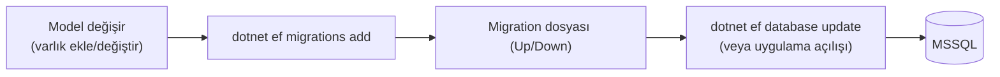

# 07 — Veritabanı & Migration'lar

Veritabanı şeması **EF Core Code-First migration'ları** ile yönetilir: C# model
değişir → migration üretilir → veritabanına uygulanır.

## Genel Akış



- Migration'lar: `backend/src/IKPro.Infrastructure/Persistence/Migrations/`
  (kiracı şeması) ve `.../Migrations/Platform/` (platform şeması)
- Her migration zaman damgalı: `20260717114308_MultiTenancyFoundation.cs`

### Kaç veritabanı migrate ediliyor?

**İki context, ama N+2 veritabanı.** `AppDbContext`'in migration'ları HER kiracı
kataloğuna ayrı ayrı uygulanır:

| Veritabanı | Şema kaynağı | Ne zaman uygulanır |
| --- | --- | --- |
| `IKProPlatform` | `PlatformDbContext` | Açılışta, otomatik |
| `IKProDb` (paylaşılan, boş) | `AppDbContext` | Açılışta, otomatik |
| `IKPro_{slug}` × N | `AppDbContext` | **Provizyonda** (yeni kiracı) + **`POST /api/tenants/migrate`** (mevcut kiracılar) |

**Kiracı veritabanları açılışta migrate EDİLMEZ.** Bu, fazın en önemli işletim
kararı ve gerekçesi somut: açılışta migrate etmek açılış süresini müşteri
sayısıyla büyütür (200 müşteride uygulama dakikalarca kapalı) ve daha kötüsü,
tek bir kiracının veritabanı erişilemez olduğunda uygulama **hiç açılmaz** —
yani bir müşterinin sorunu bütün müşterileri offline yapar. Ayrılmanın amacı
tam tersiydi.

Bunun bedeli, dağıtım adımının atlanabilmesidir. Üç yerden birden görünür kılındı:

1. **Açılış logu** — `TenantSchemaCheckService` şemaları kontrol eder (migrate
   etmez) ve geride kalanları `LogError` ile yazar.
2. **`GET /api/tenants/schema-status`** — hangi kiracı neyin gerisinde.
3. **503** — şeması geride kalan kiracının istekleri ve login'i reddedilir
   (`ITenantSchemaGuard`). Eski şemayla sessizce çalışmak veri bozulmasıdır:
   uygulama var olmayan sütunları sorgular, kısmen çalışan bir yazma yolu veriyi
   tutarsız bırakabilir.

**Development'ta seed otomatik** çalışır (`Program.cs`) ve demo kiracıları gerçek
provizyon yolundan kurduğu için şemaları zaten günceldir.

## Yeni Migration Ekleme

> **Ekim 2026 itibarıyla iki `DbContext` var** (`AppDbContext` → `IKProDb`,
> `PlatformDbContext` → `IKProPlatform`, bkz. [06](06-multi-tenancy.md)). `dotnet ef`
> hangi context olduğunu tek başına çıkaramaz ve **"More than one DbContext was
> found... Specify which one to use."** hatası verir — her komuta `--context
> AppDbContext` ya da `--context PlatformDbContext` eklemek ZORUNLUDUR. Aşağıdaki
> örnekler bunu doğrulanmış haliyle gösteriyor.

Bir varlık ekledin/değiştirdin diyelim (örnek `AppDbContext` için — kiracı verisi):

```bash
cd backend
# 1) Migration üret (Infrastructure projesi, başlangıç projesi API)
dotnet ef migrations add AçıklayıcıBirİsim \
  --project src/IKPro.Infrastructure \
  --startup-project src/IKPro.API \
  --context AppDbContext

# 2) Veritabanına uygula (ya da uygulamayı Development'ta çalıştır)
dotnet ef database update \
  --project src/IKPro.Infrastructure \
  --startup-project src/IKPro.API \
  --context AppDbContext
```

Kiracı kimliği (Tenants, TenantDirectoryEntries) değişiyorsa `--context
PlatformDbContext` kullan. Hangi context'in hangi veritabanına eşlendiğini
doğrulamak için:

```bash
dotnet ef dbcontext info --project src/IKPro.Infrastructure --startup-project src/IKPro.API --context AppDbContext
# → Database name: IKProDb
dotnet ef dbcontext info --project src/IKPro.Infrastructure --startup-project src/IKPro.API --context PlatformDbContext
# → Database name: IKProPlatform
```

> `dotnet ef` kurulu değilse: `dotnet tool install --global dotnet-ef`

**İsimlendirme:** Migration adı ne yaptığını anlatmalı (`AddEmployeePhoto`,
`MultiTenancyFoundation` gibi) — tarih otomatik eklenir.

## SQL View / Fonksiyon / Trigger

Bazı raporlar performans için ham SQL nesneleridir (view/fonksiyon). Bunlar EF ile
değil, migration içinde **`migrationBuilder.Sql("CREATE VIEW ...")`** ile yönetilir.
Örnekler: `LeaveSqlObjects`, `PayrollSummaryView`, `ComplianceReadinessView`.

> **Çok önemli (çok kiracılılık):** View'ler ve fonksiyonlar EF global filtresini
> **baypas eder**. Bu yüzden bir view yazarken `TenantId` sütununu mutlaka taşımalı,
> `fn_WorkingDays` gibi fonksiyonlar `@tenantId` parametresi almalıdır. Yeni bir
> SQL nesnesi eklerken bunu unutma (bkz. [06](06-multi-tenancy.md)).

## Seed (Örnek Veri)

Açılış sırası (yalnız Development):
1. `PlatformDbInitializer` — `IKProPlatform` migrate edilir.
2. `AppDbContextInitializer.InitialiseAsync()` — **paylaşılan** `IKProDb` migrate
   edilir. İçi boş kalır; kiracı bağlamı olmayan işler (sağlık kontrolü, henüz
   ayrılmamış kiracılar) buraya bağlandığı için var olmak zorunda.
3. `DemoTenantSeeder` — iki demo kiracıyı **gerçek provizyon yolundan** kurar
   (`IKPro_demo`, `IKPro_globex`) ve içlerini doldurur.

Demo veri: departman/personel/izin/bordro + üç kullanıcı (`ik@`, `ece.arslan@`,
`ahmet.yilmaz@` — hepsi `demo123`) ve izolasyonu göstermek için ikinci bir kiracı
(Globex, kendi üç kullanıcısıyla).

> **Seed neden provizyon yolunu kullanıyor?** Kendi kestirmesini kullansaydı,
> provizyonu bozan bir değişiklik yalnız testlerde görünürdü. Bu şekilde kayıt
> akışı, uygulamayı açan her geliştiricinin karşısında baştan sona çalışır.
> Demo admin'leri de bu yüzden şifresiz doğar; seed yalnız şifrelerini verir.

> **⚠️ Sıfırlarken:** `IKProDb` + `IKProPlatform` düşürmek ARTIK YETMEZ. Tüm
> `IKPro_*` kiracı veritabanlarını da birlikte düşürün — aksi halde provizyon
> "katalog zaten var" diye reddeder (yarıda kalmış kurulumun artığını sessizce
> yeniden kullanmamak için konulmuş bilinçli koruma).

Seed **kiracıya sabitlenmiş bir DI kapsamından** çalışır: `Program.cs` önce
`PlatformDbInitializer.EnsureDefaultTenantAsync()` ile varsayılan kiracıyı garanti
eder, sonra `ITenantScopeFactory.Create(kiracıId)` ile açtığı kapsamdan
`AppDbContextInitializer`'ı çözer.

> **Neden kapsamdan, `Impersonate` ile değil:** `AppDbContext`'in bağlantısı kapsam
> başına, **ilk çözümde** belirlenir. Initializer kök kapsamdan çözülüp içeride
> `Impersonate` çağırsaydı bağlantı çoktan kurulmuş olurdu — kiracı başına
> veritabanında seed **sessizce yanlış veritabanına** yazardı. Kapsam fabrikası
> kiracıyı kapsam dönmeden önce sabitler; sırayı yanlış yapmak imkânsız olur.
> `SeedAsync` ayrıca kiracısız kapsamda açıkça patlar (`SeedKapsamiTests`).

## Test Veritabanı

Entegrasyon testleri ayrı bir `IKProDb_Test` veritabanı kullanır ve **her koşuda
sıfırlar** (`IKProApiFactory`). Böylece testler birbirinden ve gerçek veriden yalıtılır.

## Üretim Uyarısı (satışa hazırlık)

`Program.cs` migration'ı yalnız Development'ta otomatik uygular (`PlatformDbInitializer`
ve `AppDbContextInitializer` ikisi de `if (app.Environment.IsDevelopment())` bloğunun
içindedir). Üretim dağıtımında **HER İKİ** veritabanının migration'larını elle veya bir
dağıtım adımıyla uygulaman gerekir — yalnız `AppDbContext`'i migrate edip
`PlatformDbContext`'i unutursan `IKProPlatform` üzerinde `Tenants`/`TenantDirectoryEntries`
tabloları hiç oluşmaz ve ilk login denemesi "Invalid object name 'Tenants'" ile **tam giriş
kesintisiyle** patlar:

```bash
# 1) Kiracı verisi (IKProDb)
dotnet ef database update \
  --project src/IKPro.Infrastructure --startup-project src/IKPro.API \
  --context AppDbContext --connection "<prod-app-connection>"

# 2) Kiracı kimliği (IKProPlatform) — UNUTMA, ayrı bir veritabanıdır
dotnet ef database update \
  --project src/IKPro.Infrastructure --startup-project src/IKPro.API \
  --context PlatformDbContext --connection "<prod-platform-connection>"
```

**3) KİRACI VERİTABANLARI — dağıtımın son adımı.** Yukarıdaki iki komut
müşterilerin veritabanlarına DOKUNMAZ; onlar `IKPro_{slug}` kataloglarındadır ve
`dotnet ef` onları tek tek bilmez. Uygulama yeni sürümle ayağa kalktıktan sonra:

```bash
curl -f -X POST https://<api-host>/api/tenants/migrate -H "X-Platform-Key: <platform-anahtarı>"
```

`-f` önemli: bir kiracı bile patlarsa uç 500 döner ve dağıtım script'i durur.
Diğer kiracılar yine de denenir; gövdedeki rapor hangisinin neden başarısız
olduğunu söyler. Durumu istediğiniz an `GET /api/tenants/schema-status` ile
görebilirsiniz.

Bu adım tamamlanana kadar mevcut müşteriler **503** alır — kasıtlı; eski şemayla
çalışmalarına izin vermek veri bozulması riskidir.

> **Sıra neden böyle:** uygulama önce açılmalı ki `migrate` ucu çağrılabilsin.
> Açılış kiracı şemasına bakmadığı için bu güvenli — uygulama ayakta, müşteriler
> geçici olarak 503'te, siz adımı çalıştırıp onları geri alıyorsunuz.

Ayrıca prod'da bağlantı dizeleri ve sırlar **ortam değişkeninden** gelmelidir
(`ConnectionStrings__DefaultConnection`, `ConnectionStrings__PlatformConnection`,
`Jwt__Secret` vb.); commit'li placeholder'lar prod'da reddedilir. **Tuzak:** yalnız
`ConnectionStrings__DefaultConnection`'ı override edip `PlatformConnection`'ı unutursan
uygulama verisi senin belirttiğin sunucuya, kiracı kimliği ise `appsettings.Development.json`
içindeki başka bir sunucuya bağlanır — **hata vermeden**. İkisini birlikte ayarla.

## Yerel Kurulumu Sıfırlama

Kiracı başına veritabanına geçildikten sonra iki veritabanı düşürmek **yetmez**:
demo kiracıların katalogları (`IKPro_demo`, `IKPro_globex`) yerinde kalırsa
provizyon onları "katalog zaten var" diye reddeder ve uygulama açılmaz. Bu,
yarıda kalmış bir kurulumun artığını sessizce yeniden kullanmamak için konulmuş
bilinçli bir korumadır — hata mesajı da ne yapmanız gerektiğini söyler.

**Hepsini birlikte düşürün.** Gerçek müşteri verisi yok; demo veri seed'den
yeniden üretilir:

```sql
DECLARE @sql NVARCHAR(MAX) = N'';
SELECT @sql = @sql +
    'ALTER DATABASE [' + name + '] SET SINGLE_USER WITH ROLLBACK IMMEDIATE; ' +
    'DROP DATABASE [' + name + '];'
FROM sys.databases
WHERE name IN ('IKProDb', 'IKProPlatform') OR name LIKE 'IKPro[_]%';
EXEC sp_executesql @sql;
```

Ardından uygulamayı Development'ta çalıştırın; platform migrate edilir, demo
kiracılar gerçek provizyon yolundan yeniden kurulur (kendi katalogları,
`Turkish_CI_AS` harmanlamasıyla).

## Sonraki Adım

Testler → [08 — Testler](08-testler.md).
